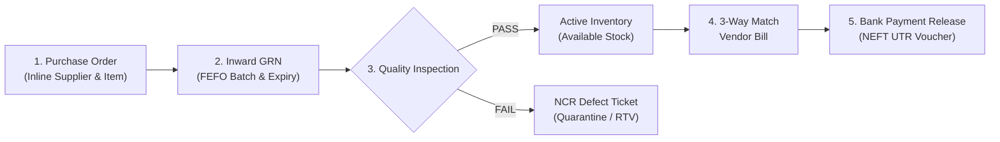
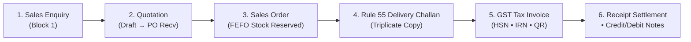

# 📘 Prodexa ERP – End-to-End UAT Testing & Validation Manual
**Standard Operating Procedure (SOP) & Step-by-Step Test Guide**

* **Document Code:** `SOP-UAT-PRD-2026-V1`
* **Version:** `v1.2.0 (UAT Release)`
* **Generated PDF Document:** [`Prodexa_ERP_UAT_Workflow_Testing_Manual.pdf`](file:///c:/Users/harsh/Documents/maufacturing-erp/Prodexa_ERP_UAT_Workflow_Testing_Manual.pdf)
* **Direct Web / Browser URL:** `http://localhost:3000/Prodexa_ERP_UAT_Workflow_Testing_Manual.pdf`
* **Direct Interactive HTML View:** `http://localhost:3000/uat-testing-guide.html`
* **Automated Unit & Integration Test Status:** `347 / 347 Passing (100%)`

---

## 1. 🔑 Role Credentials Matrix for UAT Testing

| Role & Department | Login Email (User ID) | Password | Key Permissions & Screen Scope |
| :--- | :--- | :--- | :--- |
| **🏢 Admin (Super Executive)** | `admin@inventorypro.com` | `123456789` | **Full Control** over all 10 modules, settings, overrides |
| **💼 B2B Sales Manager** | `sales@inventorypro.com` | `123456789` | Sales Desk (Enquiry, Quote, SO), Customer Master |
| **🚚 Supply Chain Manager** | `supplychain@inventorypro.com` | `123456789` | Procurement Desk (PO, Requisitions), Inward GRN, Suppliers |
| **🧪 Quality Control Inspector** | `quality@inventorypro.com` | `123456789` | Quality Inspections, Parameter Sampling, Defect NCRs |
| **🏭 Production Manager** | `production@inventorypro.com` | `123456789` | MRP Engine, Work Orders, BOM Explosion, Job Cards, Machine OEE |
| **💵 Finance Controller (CFO)** | `finance@inventorypro.com` | `123456789` | GST Tax Invoices, Vendor Bills, Payment Vouchers, Credit/Debit Notes |
| **👷 HR & Labour Superintendent** | `hr@inventorypro.com` | `123456789` | Workforce Onboarding, Shift Scheduling, Hourly Wages |

---

## 2. 📦 Master Data Setup (Prerequisites)

### TC-MD-01: Category Hierarchy Management
* **Screen:** `/dashboard/products` &bull; Click `+ New Category`
* **Input:** Name: `Processed Foods`, Code: `CAT-FOOD`, Parent: None.
* **Verification:** Category listed in hierarchy tree and selectable in product creation.

### TC-MD-02: Product Master with Dual Pricing
* **Screen:** `/dashboard/products` &bull; Click `+ Add Product`
* **Input:**
  * Name: `Premium Roasted Almonds 500g`, SKU: `ALM-500G`
  * Selling Price: `₹450.00`, Purchase Price: `₹320.00`
  * Category: `Processed Foods`, Unit: `PKT`, Min Stock: `50`
  * HSN: `200819`, GST Rate: `12%`
* **Verification:** Dual price fields saved. When creating a PO, price defaults to ₹320; in Quotations/Invoices, price defaults to ₹450.

### TC-MD-03: Supplier Master Setup
* **Screen:** `/dashboard/suppliers` &bull; Click `+ Add Supplier`
* **Input:**
  * Name: `National Agro Commodities Ltd`, Code: `SUP-001`
  * GSTIN: `27AAACN1234F1Z8`, PAN: `AAACN1234F`
  * Payment Terms: `Net 30 Days`, Lead Time: `5 Days`, City: `Mumbai`
* **Verification:** Commercial terms badges (Lead Time, GSTIN, Terms) render cleanly on supplier table.

### TC-MD-04: Customer Master Setup
* **Screen:** `/dashboard/sales` or `/dashboard/orders` &bull; Click `+ New Customer`
* **Input:**
  * Name: `Apex Supermarket Retail Chain`, Contact: `Rajesh Sharma`
  * GSTIN: `24AABCA5678E1Z4` (Gujarat)
  * Address: `S.G. Highway, Bodakdev`, City: `Ahmedabad`, Pin: `380054`
  * Credit Limit: `₹5,00,000`, Terms: `Net 15 Days`
* **Verification:** State code automatically auto-fills as `24` from GSTIN prefix.

---

## 3. 📑 Procure-to-Pay (P2P) Testing Cycle

1. **TC-P2P-01 (PO Creation):** Create PO at `/dashboard/purchase`. Select Supplier `National Agro Commodities Ltd`. Add 200 PKT of `Premium Roasted Almonds 500g`. Verify purchase rate auto-fills at ₹320. Total: ₹64,000 + GST. Status flips to `APPROVED`.
2. **TC-P2P-02 (Inward GRN):** Create GRN for 200 PKT. Assign Batch `BAT-ALM-2610A` and Expiry Date `30/04/2027`. Select Bin `Bay-A / Cold Storage Rack 2`.
3. **TC-P2P-03 (Quality & NCR):** Log in as `quality@inventorypro.com`.
   * **Pass Test:** Approve parameters &rarr; Stock enters Active Inventory.
   * **Fail Test:** Reject with reason &rarr; Pop-up logs NCR with Severity (Major) and Disposition (Return to Vendor).
4. **TC-P2P-04 (Vendor Bill & 3-Way Match):** Generate Vendor Bill in `/dashboard/finance`. Match PO - GRN - Bill. Net Payable: ₹71,680.00.
5. **TC-P2P-05 (Payment Release):** Release payment via NEFT with UTR `HDFCN26289012345`. Bill status updates to `PAID`.

---

## 4. 🚚 Order-to-Cash (O2C) Full Lifecycle

### TC-O2C-01: Sales Enquiry
* Log in as `sales@inventorypro.com`. Open `/dashboard/sales` (Block 1).
* Add Enquiry: Customer `Apex Supermarket Retail Chain`, Item: `Premium Roasted Almonds 500g` (100 PKT).

### TC-O2C-02: Sales Quotation Formulation
* Convert Enquiry to Quotation (Block 2).
* Item rate defaults to ₹450.00. Apply 5% discount (₹2,250.00). Taxable: ₹42,750.00.
* IGST 12%: ₹5,130.00. Net Quotation Total: ₹47,880.00.
* Advance Status: `DRAFT` &rarr; `SENT` &rarr; `PO_RECEIVED` (Customer PO: `APEX-PO-8812`).

### TC-O2C-03: Confirmed Sales Order & FEFO Stock Allocation
* Click `Confirm as Sales Order` (Block 3).
* System assigns sequential order number `SO-2026-0089`.
* **FEFO Allocation Engine:** Automatically scans available batches, picks earliest expiry batch `BAT-ALM-2610A`, and reserves 100 PKT.
* Credit Limit check passes (₹47,880 &le; ₹5,00,000 limit).

### TC-O2C-04: Pick, Pack & Delivery Challan (Rule 55 CGST)
* Open `/dashboard/dispatch`. Select confirmed order `SO-2026-0089`.
* Generate Pick List & mark Packed.
* Click `Generate Delivery Challan (Rule 55)`. Enter Transporter `SafeXpress Logistics`, Vehicle `MH-04-AB-1234`.
* **Statutory Compliance Check:**
  * Challan prints in **Triplicate**:
    1. *Original for Consignee*
    2. *Duplicate for Transporter*
    3. *Triplicate for Consignor*
  * Commercial values are suppressed (showing batch, HSN, quantity & "Delivery under Challan - Not for Sale").

### TC-O2C-05: GST Tax Invoice Generation
* Open `/dashboard/finance` &bull; locate Challan `DC-2026-0031`.
* Click `Convert to Tax Invoice` (e.g. `INV/2026-27/0114`).
* HSN summary table renders 6-digit HSN `200819`, Taxable ₹42,750, IGST ₹5,130, Total ₹47,880.
* IRN / E-Way Bill placeholders verified.

### TC-O2C-06: Customer Inward Payment Settlement
* In `/dashboard/finance`, click `Record Customer Receipt`.
* Select Customer `Apex Supermarket Retail Chain` & settle Invoice `INV/2026-27/0114`.
* Record RTGS Ref `AXIS-R-261908` for ₹47,880.00. Invoice status updates to `PAID`.

### TC-O2C-07: Credit Notes & Debit Notes
* **Credit Note (Transit Return):** Issue Credit Note against invoice for 10 PKT (₹4,788.00 incl. GST). Stock inwards into Damaged/Scrap Store; output GST liability reduced.
* **Debit Note (Supplementary Freight):** Issue Debit Note for ₹2,360.00 (Express Reefer charge). Customer receivable balance increases.

---

## 5. 🔗 Document Connectivity & Lineage Bar
* Open any transactional document (SO, PO, DC, Invoice).
* Check the **Document Lineage Bar**:
  `[Enquiry] ➔ [Quotation] ➔ [Sales Order] ➔ [Delivery Challan] ➔ [Tax Invoice] ➔ [Payment Receipt]`
* Click any node to open the summary side-drawer in 1 click.

---

## 6. 🛡️ Regulatory & Edge Case Validation
1. **Zero Stock Blockage:** Challan generation strictly prevented if requested quantity exceeds free batch balance.
2. **Expired Batch Blockage:** Batches past their expiry date are strictly excluded by the FEFO engine.
3. **RBAC Guardrails:** Sales users cannot authorize financial payment vouchers or post vendor bills.
4. **Offline Resilience:** In-memory fallback stores guarantee zero server crashes if the database connection drops.

---

## 7. 📄 Physical Sign-Off & Defect Form
The printed PDF version contains formal defect logging tables and signature blocks for:
* Sales & Commercial Lead
* Procurement & Stores Lead
* Quality Assurance Lead
* Manufacturing Operations Lead
* Finance Controller (CFO)
* Lead QA / Delivery Manager
