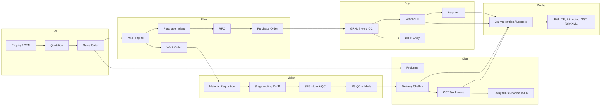
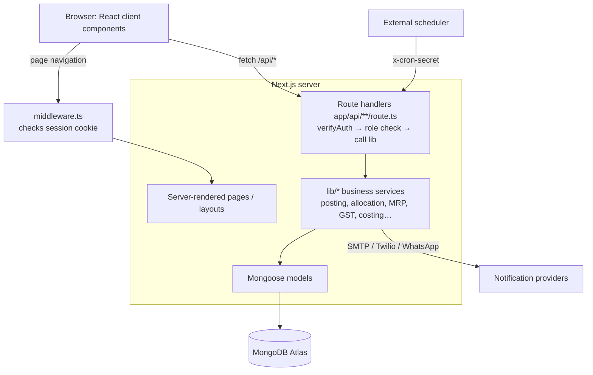

# Prodexa ERP – Architecture

> Generated from a read-through of the codebase at `maufacturing-erp` (Oct 2026): `package.json`, `middleware.ts`, `lib/*`, `models/*`, every `app/api/**/route.ts` signature, the dashboard navigation, and the existing planning docs. Statements marked **(inferred)** come from names and comments rather than from reading every line of a screen.

## 1. What the software is

Prodexa is a web-based **manufacturing ERP** for a discrete manufacturer (the seed data and chart of accounts are for a **bicycle maker**: frames, drivetrains, tyres, brakes, crates). It follows the Synture "Prodexa ERP Enterprises Business Module" flow chart, and it started life as a smaller *food inventory system* (`srs.md`, `flow.md`, `modules.md` describe that first scope: batches, expiry, FEFO). The product has since grown into a full order-to-cash / procure-to-pay / plan-to-produce system with Indian GST compliance.

The project folder is named `maufacturing-erp`; `package.json` still calls the package `inventory`.

### The big picture



## 2. Technology stack

| Layer | Choice | Evidence |
|---|---|---|
| Framework | **Next.js 16.2 (App Router)**, React 19.2, TypeScript 5 | `package.json`, `app/` |
| Styling / UI | Tailwind CSS 4 (`@tailwindcss/postcss`), `lucide-react` icons, `recharts` charts, Bricolage Grotesque + DM Sans fonts | `package.json`, `app/globals.css` |
| Database | **MongoDB** (Atlas) via **Mongoose 9** | `lib/mongodb.ts`, `models/*` |
| Auth | Custom: `bcryptjs` password hash, **JWT (HS256, `jose`)** in an `httpOnly` cookie named `session`, 24 h expiry | `lib/auth.ts`, `app/api/auth/*` |
| Validation | `zod` 4 (dependency present); much validation is hand-written in routes/libs | `package.json` |
| Documents | `pdf-lib` (PO PDF), `jsbarcode` + `qrcode` (labels) | `lib/poPdf.ts`, `lib/labels.ts` |
| Messaging | `nodemailer` (email); Twilio (SMS) and WhatsApp Cloud API called with `fetch` | `lib/notify.ts` |
| Files | MongoDB-stored attachments (`Buffer`), plus Cloudinary variables in `.env` **(inferred: not seen in code paths read)** | `models/Attachment.ts` |
| Testing | **Vitest 4** + `mongodb-memory-server`; 44 unit and integration test files | `tests/`, `vitest.config.ts` |
| Tooling | ESLint 9, `tsx` for scripts (`npm run db:seed`) | `package.json` |

There is **no separate backend service**: the Next.js app serves the UI, the REST-style API (`app/api/**/route.ts`) and the business logic (`lib/*`) in one deployable.

## 3. Repository layout

```
maufacturing-erp/
├── app/
│   ├── page.tsx, industries/, docs/        Public marketing pages (landing, industries, docs)
│   ├── (auth)/login, register              Auth screens
│   ├── (dashboard)/layout.tsx              Authenticated shell (reads session, renders sidebar)
│   ├── (dashboard)/dashboard/**/page.tsx   ~38 ERP screens (one per module; 44 `page.tsx` files in total incl. public pages)
│   ├── vendor-ack/[token]/page.tsx         Public page a supplier opens to acknowledge a PO
│   └── api/**/route.ts                     123 route handlers (REST-ish JSON)
├── components/
│   ├── layout/DashboardLayoutClient.tsx    Sidebar, role-based nav, header
│   ├── modals/*                            ~25 create/edit forms (PO, GRN, invoice, BOM, …)
│   ├── common/*                            Lineage drawer, attachment drawer, MRP planner, GST document, job-card button, loss analytics
│   ├── landing/*                           Marketing-site widgets
│   └── ui/index.tsx                        Shared UI primitives
├── lib/                                    50 files of business logic (no UI) – the heart of the system
├── models/                                 57 Mongoose schemas
├── middleware.ts                           Page-route guard (cookie → redirect)
├── tests/ (+ tests/integration/)           Vitest suites
├── docs/                                   Development plan, pending items, tester PDF + Excel test plan
└── *.md, task*, implementation_plan*       Historical planning notes
```

## 4. Runtime architecture



### Request lifecycle (API)
1. Browser calls e.g. `POST /api/sales-orders`.
2. The route handler calls `dbConnect()` (cached connection – `lib/mongodb.ts`) and `verifyAuth(req)` (decodes the `session` cookie JWT → `{id,name,email,role}`).
3. It checks the **role** against an allow-list written in the route (or helpers like `canViewFinance`).
4. It delegates to a `lib/*` service which performs the multi-step business operation.
5. Errors are thrown as `HttpError(status, message)` (`lib/httpError.ts`) and mapped to HTTP codes; a message containing "locked" maps to **422** (period lock).
6. Important actions write to the **audit log** (`lib/audit.ts`).

The original `flow.md` describes the layers as `UI → API route → Service layer → MongoDB`; `lib/` is that service layer.

### Authentication & route protection
- `middleware.ts` runs on page routes only (its matcher **excludes `/api`**, static files and images). It redirects unauthenticated users on `/dashboard…` (and a few legacy prefixes) to `/login`, and authenticated users on `/`, `/login`, `/signup` to `/dashboard`.
- **Every API route performs its own `verifyAuth`.** A test (`tests/integration/auth-coverage.test.ts`) exists to keep new endpoints behind a login.
- The sidebar (`DashboardLayoutClient.tsx`) holds a per-route role map and only shows modules the role may open; the API enforces the real permission.

## 5. Core design patterns (the "how it behaves" rules)

| Pattern | What it means in practice | Where |
|---|---|---|
| **Batch-level inventory** | Stock is never a single number; it lives in `Batch` rows with expiry, cost (`purchasePrice`), store (`QUARANTINE`, `W1/W2/W3`, `SFG`, `FG`, `SCRAP`), QC status, `currentQuantity` and `allocatedQuantity`. | `models/Batch.ts` |
| **FEFO reservation** | Allocation sorts batches by earliest expiry and uses atomic `$inc` on `allocatedQuantity`. Only non-expired, QC-cleared batches qualify. | `lib/allocation.ts`, `lib/mrn.ts` |
| **QC hard gate** | Goods land in `QUARANTINE`; batches that are `REJECTED`, `ON_HOLD` or `PENDING_QC` can never be allocated. | `allocation.ts`, `GRN` PATCH |
| **Double-entry accounting** | Every money event posts a balanced `JournalEntry` and updates `Account.balance`. Standard ledger codes live in `ACC`. | `lib/accounting.ts` |
| **Voucher + journal together** | A `Voucher` is created with its journal; if the voucher cannot be saved the journal is reverted. | `postVoucher`, `revertJournal` |
| **Period lock** | Accounting/inventory dates on or before `lockedUpTo` are refused. | `assertPeriodOpen`, `models/PeriodLock.ts` |
| **Guarded, undoable steps** | Multi-step operations claim quantities with conditional updates, and put them back if a later step fails (dispatch, returns, payments, job work). | `dispatch.ts`, `payables.ts`, `purchaseReturn.ts`, `jobworkOutward.ts` |
| **Idempotency** | Approved vouchers are created "exactly once" using the approval-request id as `idempotencyKey` (unique partial index); payments reject a duplicate UTR; double clicks reuse the first result. | `voucherPosting.ts`, `payables.ts` |
| **Sequential document numbers** | `PREFIX-YYYY-0001` with retry on unique-index collision. | `lib/docNumber.ts` |
| **Configurable approval matrix** | Rules (module + min amount → ordered approver roles) decide if a document waits for approval; the outcome is applied to the source document when fully decided. | `lib/approvals.ts`, `models/ApprovalMatrix.ts` |
| **Document lineage** | Child documents store real ObjectId refs to parents; `buildLineage` walks both ways to return a graph (nodes+edges). Money nodes are hidden from non-finance roles. | `lib/lineage.ts` |
| **Role views** | Finance, invoice and party data have shared role lists. | `lib/accessRoles.ts` |
| **PII masking** | Phone/email/bank numbers are masked for the Executive Viewer. | `lib/pii.ts` |
| **Audit trail** | Who/what/when for create, edit, approve, delete, override, reject, login. | `lib/audit.ts`, `models/AuditLog.ts` |
| **Best-effort notifications** | `notify()` never throws; unconfigured providers log `SKIPPED`. | `lib/notify.ts` |

## 6. Module map (UI ↔ API ↔ lib ↔ models)

| Module | Screen(s) | API prefix | Main lib | Main models |
|---|---|---|---|---|
| Auth & users | `/login`, `/register` | `/api/auth/*` | `auth.ts` | `User` |
| Products, categories, BOM | `/dashboard/products` | `/api/products`, `/api/categories`, `/api/production/bom` | – | `Product`, `Category`, `BillOfMaterials` |
| Inventory & batches | `/dashboard/inventory` | `/api/inventory/*` | `allocation.ts`, `inventoryValuation.ts`, `replenishmentEngine.ts` | `Batch`, `CycleCount`, `StockTransferOrder` |
| CRM / enquiries / quotes | `/dashboard/sales`, `/crm` | `/api/enquiries`, `/api/quotations`, `/api/followups`, `/api/cron/followups` | `quoteTerms.ts`, `notify.ts` | `Enquiry`, `Quotation` |
| Sales orders & Order Desk | `/dashboard/orders`, `/order-desk` | `/api/sales-orders/*`, `/api/orders` | `salesOrderApproval.ts`, `salesOrderEdit.ts`, `salesOrderMrp.ts` | `SalesOrder`, `Order` (legacy) |
| MRP & planning | `/dashboard/mrp`, `/procurement` | `/api/mrp/*`, `/api/forecasts` | `mrpEngine.ts`, `workOrderPlan.ts` | `MRPRun`, `SalesProjection`, `PurchaseIndent` |
| Purchasing | `/dashboard/purchase`, `/suppliers` | `/api/purchase*`, `/api/rfqs`, `/api/purchase-indents`, `/api/suppliers`, `/api/vendor-ack` | `poPdf.ts`, `notify.ts` | `PurchaseOrder`, `RFQ`, `Supplier` |
| Goods receipt & QC | `/dashboard/grn`, `/quality` | `/api/grn`, `/api/quality`, `/api/quality/ncr` | `warehouses.ts` | `GRN`, `QualityCheck`, `QualityStandard`, `NonConformance` |
| Imports | `/dashboard/bill-of-entry` | `/api/bill-of-entry` | `billOfEntry.ts` | `BillOfEntry` |
| Purchase returns | (GRN screen) | `/api/purchase-returns` | `purchaseReturn.ts` | `PurchaseReturn` |
| Vendor bills & payables | `/dashboard/vendor-bills` | `/api/vendor-bills/*` | `vendorBill.ts`, `payables.ts`, `creditorAging.ts` | `Invoice` (type PURCHASE), `Voucher` |
| Production & WIP | `/dashboard/production`, `/production/wip` | `/api/production/*`, `/api/sfg/*`, `/api/scrap` | `mrn.ts`, `costing.ts`, `woNumber.ts` | `WorkOrder`, `MaterialRequisition`, `SFGStock`, `ScrapEntry`, `ProductionLog` |
| Machines & OEE | `/dashboard/oee` | `/api/oee`, `/api/machine-runs` | `oee.ts` | `Machine`, `MachineRun` |
| Labels | `/dashboard/labels` | – (client + lib) | `labels.ts` | – |
| Dispatch & GST docs | `/dashboard/dispatch` | `/api/delivery-challans`, `/api/proforma`, `/api/dispatch/invoices` | `dispatch.ts`, `invoicing.ts`, `einvoice.ts`, `gst.ts` | `DeliveryChallan`, `ProformaInvoice`, `Invoice` |
| Job work | `/dashboard/jobwork` | `/api/jobwork/*` | `jobwork.ts`, `jobworkOutward.ts` | `JobWorkOrder` |
| Finance | `/dashboard/finance`, `/vouchers`, `/accounting-reports`, `/gst`, `/tally` | `/api/finance/*`, `/api/vouchers`, `/api/accounts`, `/api/gst`, `/api/tally/export` | `accounting.ts`, `voucherPosting.ts`, `voucherBuilder.ts`, `reportMath.ts`, `tally.ts` | `Account`, `JournalEntry`, `Voucher`, `Payment`, `GSTReturn`, `FixedAsset` |
| Governance | `/dashboard/approvals`, `/approval-matrix`, `/period-lock`, `/audit` | `/api/approvals/*`, `/api/settings/*`, `/api/audit` | `approvals.ts`, `audit.ts` | `ApprovalRule/Request`, `ApprovalThreshold`, `PeriodLock`, `AuditLog` |
| Notifications | `/dashboard/notifications` | `/api/notifications/*` | `notify.ts`, `notifyTemplate.ts` | `NotificationTemplate/Log` |
| Documents (DMS) | drawers on many screens | `/api/attachments` | `attachmentAccess.ts` | `Attachment` |
| Lineage | “Chain” drawers | `/api/lineage` | `lineage.ts`, `lineageBackfill.ts` | refs across models |
| HR / labour | `/dashboard/labour` | `/api/labour/*` | – | `Worker`, `AttendanceRecord`, `LabourJob` |
| Projects | `/dashboard/projects` | `/api/projects` | – | `Project`, `Milestone`, `ProjectTask` |
| Supply chain / export | `/dashboard/supply-chain`, `/export-import` | `/api/supply-chain`, `/api/export-import` | – | `Shipment`, `ExportDocument` |
| BI / reports | `/dashboard/bi`, `/reports` | `/api/bi`, `/api/reports` | `pivot.ts`, `reportMath.ts` | `ReportTemplate` |

## 7. Cross-cutting concerns

### Accounting engine
`lib/accounting.ts` defines the standard ledgers (`ACC`: cash 1005, petty cash 1006, bank 1010, AR 1020, RM/WIP/FG inventory 1030/1035/1040, GST input 1060, AP 2010, GST output 2020, TDS 2030, sales 4010, job-work income 4040, sales returns 4090, COGS 5010, overhead 5040, scrap loss 5050, price variance 5060). Ledgers are created on first use. `postJournal` refuses unbalanced entries and locked periods. Higher-level builders (`voucherBuilder`, `voucherPosting`, `invoicing`, `costing`, `vendorBill`, `billOfEntry`, `purchaseReturn`) compose journal lines for each business event.

### Cost flow (materials only)
```
Goods received            Dr Raw-material inventory   Cr Payables
Issue to work order       Dr WIP                      Cr RM inventory
FG approved               Dr FG inventory             Cr WIP
Rejected units            Dr Scrap loss               Cr WIP
Dispatch                  Dr COGS                     Cr FG inventory
Bill of Entry (import)    Dr RM inventory (duty) + Dr Input GST (IGST)   Cr Bank/Cash
```
Labour and overhead are **not** absorbed (open decision D6 in `docs/Pending-Items.md`).

### GST
`lib/gst.ts` validates GSTIN, derives state code, and `computeTax` splits CGST+SGST (intra-state) or IGST (inter-state), rounds per line and builds the HSN summary and amount-in-words. `lib/einvoice.ts` builds **NIC e-invoice (schema 1.1) and e-way bill JSON** plus a deterministic IRN hash — the actual IRN/e-way number must come from the government portal and is recorded by hand.

### Notifications
Events: `PO_DISPATCH`, `ORDER_CONFIRMATION`, `DISPATCH_ALERT`, `FOLLOWUP_DUE`; channels: `EMAIL`, `SMS`, `WHATSAPP`. Templates use `{{variables}}`. Providers are enabled by environment variables (SMTP_*, TWILIO_*, WHATSAPP_*); without them messages are logged as `SKIPPED`.

### Scheduled work
`POST /api/cron/followups` (header `x-cron-secret`) emails one reminder per overdue enquiry follow-up. Nothing in the repo schedules it; an external scheduler must call it.

## 8. Configuration (names only — values are secrets)

`.env` contains: `MONGODB_URI`, `AUTH_SECRET` is read by code (`lib/auth.ts`) **but was not listed in `.env`** — see risks; SMTP: `SMTP_HOST/PORT/USER/PASS/FROM/SECURE`; `BREVO_API_KEY`; `CLOUDINARY_CLOUD_NAME/API_KEY/API_SECRET`. Code also reads `TWILIO_ACCOUNT_SID/AUTH_TOKEN/FROM`, `WHATSAPP_TOKEN/PHONE_ID`, `CRON_SECRET`, `FOLLOWUP_ALERT_EMAIL`.

## 9. Observations & risks worth knowing

1. **`AUTH_SECRET` fallback.** `lib/auth.ts` falls back to the literal `'your-default-secret-key'`. If `AUTH_SECRET` is not set in production, anyone can forge a session. Set a long random secret.
2. **`GET /api/seed?key=…` clears existing data** and recreates demo users. It is guarded only by a key that is **hard-coded in the source file**, so anyone with the code (or repo access) can wipe the database if the endpoint is reachable. Remove it or disable it in production.
2b. **Demo-login fallback in `POST /api/auth/login`.** If the database user is not found or the DB is unreachable, the route checks a hard-coded list of demo accounts (e.g. `admin@inventorypro.com` / a documented demo password, and an `admin@auma.com` account). This works **even when the DB is healthy**, so in production anyone who knows those credentials can sign in as ADMIN. Remove the fallback outside local demos.
3. **Secrets in the working folder.** `.env` holds live-looking credentials and `credentials.md` exists. `docs/Pending-Items.md` itself says the Atlas password should be rotated. `.gitignore` excludes `.env*`, but **`credentials.md` is not excluded** — check whether it is committed and remove it from history if so.
4. **DNS override.** `lib/mongodb.ts` forces DNS servers `8.8.8.8/1.1.1.1` to work around Windows/ISP SRV blocking for Atlas. Harmless locally; reconsider in locked-down networks.
5. **Legacy/dual models.** `Order` (old FEFO order) coexists with `SalesOrder`; `memorySalesOrders`, `memoryAutoPOs`, `memoryAuditLogs` are in-memory fallbacks. New work should use `SalesOrder` and the DB.
6. **Open items** are tracked in `docs/Pending-Items.md`: no browser pass done on recent screens, ~1,500 lint warnings, several read endpoints open to any logged-in role, request-body spreading in older routes, no invoice cancellation, no supplier-refund entry.
7. **E2E external integrations are not live:** email/SMS/WhatsApp need credentials; NIC e-invoice/e-way upload is manual.
