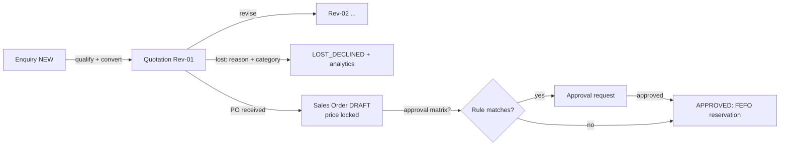
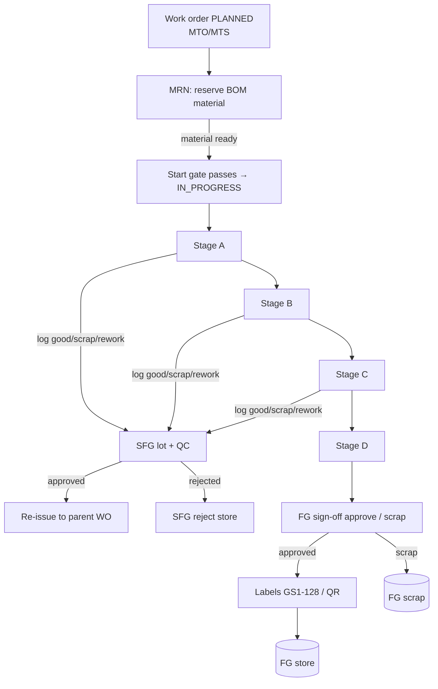
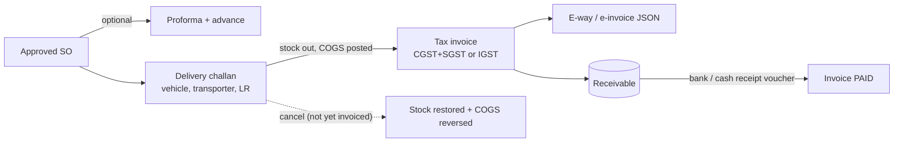

# Prodexa ERP – End-to-End Business Flows

How documents move through the system, which rules fire, and what ends up in the books. Each flow lists the **code that implements it**.

---

## 1. Lead to order



Rules: loss requires category + reason · prices/terms locked after conversion (override needs reason, audited) · approval reserves earliest-expiry QC-cleared batches, shortfall recorded, no failure for partial stock.
Code: `app/api/enquiries`, `quotations`, `lib/salesOrderApproval.ts`, `salesOrderEdit.ts`, `allocation.ts`.

## 2. Plan: MRP → indent → RFQ → PO / work order

1. **Run MRP** (all demand, or *for one sales order*). Explodes BOM levels, nets against free stock + open POs + open WOs (+ reorder level for general runs).
2. For each row with `netIndentQty > 0`: **PURCHASE** rows → *Purchase Indent*; **WORK_ORDER** rows → *Work Order* (sub-assemblies scheduled to finish before parents).
3. Indents → approve → consolidated **RFQ** → vendors quote → compare → **award** → **Purchase Order** (inherits the sales-order tag).
4. Re-running does not duplicate: quantities already on open indents count as supply (`salesOrderMrp.openIndentQuantities`).

Code: `lib/mrpEngine.ts`, `salesOrderMrp.ts`, `workOrderPlan.ts`, `app/api/mrp/*`, `rfqs`, `purchase-indents`.

## 3. Procure to pay

```mermaid
sequenceDiagram
  participant SC as Supply chain
  participant AM as Approval matrix
  participant V as Vendor
  participant W as Warehouse / QC
  participant F as Finance
  SC->>AM: PO (amount)
  AM-->>SC: approved (or rejected → DRAFT)
  SC->>V: PO PDF by email + ack link
  V->>W: goods + challan
  W->>W: GRN (gate entry) → QUARANTINE
  W->>W: Inspect: accept / scrap / return, tests
  W->>W: Put-away W1/W2/W3 (batches approved)
  Note over W,F: Dr RM inventory / Cr Payables (at receipt price)
  F->>F: Vendor bill (3-way match) → GST input + price variance
  F->>AM: Release payment (if rule)
  AM-->>F: approved
  F->>F: Payment voucher + UTR; bill settled
```

Special cases
- **Import:** add a *Bill of Entry* → duty capitalised into batch cost, IGST to Input GST.
- **Return to vendor:** before billing → goods only; after billing → reverses bill value + GST + variance; paid bill blocked.
- **Advance to supplier:** pay with no bill, later apply to a bill.
- **Received-not-billed (GRNI)** is visible in creditors aging.

Code: `lib/vendorBill.ts`, `payables.ts`, `purchaseReturn.ts`, `billOfEntry.ts`, `creditorAging.ts`, `app/api/grn`, `vendor-bills`, `purchase-returns`, `bill-of-entry`.

## 4. Make: work order to finished goods



Books: material issue `Dr WIP / Cr RM inventory`; FG approval `Dr FG inv / Cr WIP`; scrap `Dr Scrap loss / Cr WIP`. Unit cost = material cost not yet moved ÷ units not yet decided. (Materials only.)
Code: `lib/mrn.ts`, `costing.ts`, `app/api/production/*`, `sfg/*`, `lib/labels.ts`.

## 5. Dispatch to cash



Books: challan `Dr COGS / Cr FG inventory`; invoice `Dr AR / Cr Sales + Output GST`; receipt `Dr Bank/Cash / Cr AR`. Corrections after invoicing are **credit notes** (no invoice cancel yet).
Code: `lib/dispatch.ts`, `invoicing.ts`, `einvoice.ts`, `costing.ts`, `app/api/delivery-challans`, `dispatch/invoices`, `proforma`.

## 6. Job work

- **Outward:** plan batches & value → (approval if rule) → atomic stock deduction → challan → PO to job worker → record receipts (output/consumed/returned/scrap) → close. ITC‑04 clock: 1 yr (inputs) / 3 yrs (capital goods).
- **Inward:** receive customer material (no valuation) → service SO → process → return challan(s) → service invoice (SAC 9988, 18% GST) → job-work income.
Code: `lib/jobwork.ts`, `jobworkOutward.ts`, `app/api/jobwork/*`.

## 7. Approvals

1. Document is submitted; `requestApproval` picks the rule with the **highest threshold ≤ amount** for that module.
2. A request with ordered levels is created (`PENDING`); a unique partial index prevents two live requests for one document.
3. The approver whose role is the current level (or Admin) approves/rejects with remarks.
4. When the last level approves, `applyOutcome` acts: PO → `ORDERED`; SO → approve + reserve stock; vouchers → post exactly once; outward job work → re-plan stock and issue challan. If applying fails (period locked, stock gone) the request stays pending.

## 8. Accounting period control

`assertPeriodOpen('ACCOUNTING' | 'INVENTORY', date)` is called by `postJournal` and stock operations; a locked period returns HTTP 422 with the lock date.

## 9. Status cheat-sheet

| Document | States |
|---|---|
| Enquiry | NEW → QUALIFIED / REJECTED |
| Quotation stage | ENQUIRY_RECEIVED → QUOTATION_SENT → UNDER_REVIEW → PO_RECEIVED / LOST_DECLINED |
| Sales order | DRAFT → APPROVED → IN_FULFILLMENT → FULFILLED / CANCELLED; DRAFT, APPROVED or IN_FULFILLMENT ⇄ ON_HOLD (release returns to the held state) |
| Purchase order | DRAFT → PENDING_APPROVAL → ORDERED → PARTIALLY_RECEIVED → RECEIVED / CANCELLED |
| GRN | QUARANTINE → QC_DONE → PUT_AWAY |
| Batch QC | PENDING_QC → APPROVED / REJECTED / ON_HOLD |
| Work order | PLANNED → IN_PROGRESS → COMPLETED / ON_HOLD / CANCELLED |
| MRN | DRAFT → RESERVED → PARTIALLY_ISSUED → ISSUED / CANCELLED |
| Delivery challan | ISSUED → INVOICED / CANCELLED |
| Invoice | DRAFT → ISSUED → PARTIAL → PAID / CANCELLED |
| Job work | OPEN → PARTIAL → CLOSED |
| Approval request | PENDING → APPROVED / REJECTED |
| Quotation discount request | PENDING → APPROVED (applied as a revision) / REJECTED; within the requester's authority it is approved at once |
| Cycle count | PLANNED → IN_PROGRESS → PENDING_APPROVAL → POSTED / CANCELLED |
| Stock transfer | DRAFT → DISPATCHED → RECEIVED / CANCELLED |
