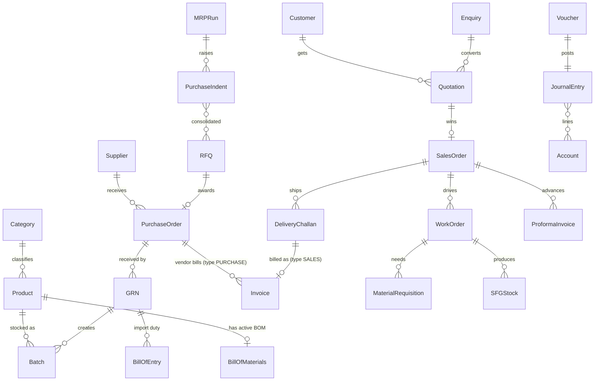

# Prodexa ERP – Data Model Reference

MongoDB collections defined as Mongoose schemas in `models/*.ts` (≈60 files). Only the important fields are listed; `createdAt/updatedAt` exist on almost all. `→` means an ObjectId reference.

## 1. Entity-relationship overview

## 2. Master data

| Model | Key fields | Notes |
|---|---|---|
| **User** | name, email (unique), password (bcrypt, `select:false`), role, isActive | Roles: ADMIN, MANAGER, STAFF, SALES, VIEWER, PRODUCTION_MANAGER, QUALITY_INSPECTOR, FINANCE_MANAGER, HR_MANAGER, SUPPLY_CHAIN_MANAGER (default VIEWER) |
| **Category** | name, slug, parentId → Category | Hierarchical |
| **Product** | name, sku (unique), category →, uom, barcode, minStockLevel (reorder point), price, **minSellingPrice** (MSP), purchasePrice (moving average price), productType (RAW_MATERIAL / SEMI_FINISHED / FINISHED_GOOD / PACKAGING / TRADING_GOOD / SPARE_PART / SERVICE), grossWeight, netWeight, oemName, oemPartNumber, plant, mrpType (PD / VB / ND), safetyStock, plannedDeliveryDays, storageBin, batchManaged, valuationClass, priceControl (V / S), bomId →, hsnCode, gstRate (default 18), isActive | Layout of the ERP Material Master Template (MARA / MARC / MBEW). SAP codes and template labels ("HAWA (Trading Goods)") are accepted and stored as codes. Total stock and value come from batches, not stored |
| **BillOfMaterials** | product →, version, status (DRAFT/ACTIVE/OBSOLETE), components[ {product, quantity, unit, wastagePercentage} ], routingSteps[ {stepNumber, description, machineType, estimatedTimeMinutes} ] | Latest-updated ACTIVE BOM wins in MRP |
| **Supplier** | name, name2, code (unique, Vendor ID), accountGroup (DOMESTIC / FOREIGN / SERVICE_PROVIDER / ONE_TIME), searchTerm, contact, email, phone, address, city, pincode, region, country (default IN), gstin + pan (India) or taxId + vatNumber (foreign), bankDetails, companyCode, reconciliationAccount, paymentTerms, paymentMethod, toleranceGroup, withholdingTaxCode, purchasingOrg, orderCurrency (default INR), incoterm, minOrderValue, pricingSchemaGroup, orderingAddress / invoicingParty (partner Vendor IDs), performanceRating, certifications[], leadTime, isActive | Layout of the ERP Vendor Master Template (LFA1 / LFB1 / LFM1). A foreign tax number never goes into gstin, which drives the GST state |
| **Customer** | name, code (unique, Customer ID), accountGroup (SOLD_TO / SHIP_TO / BILL_TO / PAYER), searchTerm, gstin, pan (India) or taxId (foreign), contactPerson, email, phone, billingAddress, city, pincode, region, country (default IN), stateCode, shippingAddresses[], companyCode, reconciliationAccount, paymentTerms, paymentMethod, dunningProcedure, creditLimit, salesAreas[ {salesOrg, distributionChannel, division, salesDistrict, pricingProcedure, shippingConditions, incoterm} ] | Layout of the ERP Customer Master Template (KNA1 / KNB1 / KNVV); sales org, channel and division come from its Reference_Data lists |
| **CompanySettings** | key `company`, legalName, gstin, pan, city, pincode, stateCode, bank{}, invoiceTerms | Singleton |
| **Machine** | name, code, type, location, status, capacity, maintenanceSchedule | |
| **Worker** | name, employeeId, department, skills[], shift, dailyRate, overtimeRate, status | |
| **QualityStandard** | product →, version, status, parameters[ {name, unit, minValue, maxValue, method} ] | |
| **Account** | code (unique), name, type (ASSET/LIABILITY/EQUITY/REVENUE/EXPENSE), category, balance, currency, isActive | Chart of accounts; balance updated on every journal |
| **FixedAsset** | assetTag, name, category, purchaseDate, originalCost, salvageValue, usefulLifeYears, accumulatedDepreciation, status | |

## 3. Inventory

| Model | Key fields |
|---|---|
| **Batch** | product →, batchNumber (unique), manufacturingDate, expiryDate, initialQuantity, currentQuantity, allocatedQuantity, purchasePrice (unit cost), po →, grn →, location, **store** (system stores QUARANTINE, SFG, FG, SCRAP, or a StorageLocation code such as W1), zone/rack/bin, **qualityStatus** (PENDING_QC, APPROVED, REJECTED, ON_HOLD), qualityChecks[] → |
| **CycleCount** | countNumber, warehouse, scheduledDate, status, items[ {batch, systemQuantity, countedQuantity, variance, unitCost, varianceValue} ], totals, approvedBy |
| **StockTransferOrder** | transferNumber, fromWarehouse, toWarehouse, status, items[], carrier, vehicle/driver, ewayBillNumber, dates |
| **MaterialRequisition** | number, workOrder →, items[ {product, requiredQty, reservedQty, issuedQty} ], status, shortfall |
| **SFGStock** | batchCode (unique), workOrder →, product →, stageSeq/Name, inputQty, quantity, remainingQty, conversionRatio, qcStatus (PENDING/APPROVED/REJECTED), qcRejectedQty, qcBy/qcSignature/qcReason, reissues[] |
| **StorageLocation** | code (unique; not a system store), name, plant, zones[], racks[], bins[] (an empty list = that level not used), isActive. W1–W3 are created on first use |
| **ScrapEntry** | store (SFG_SCRAP/SFG_REJECT/FG_SCRAP/RM_SCRAP), workOrder →, stageName, product →, quantity, reason, operator |

## 4. Sell side

| Model | Key fields |
|---|---|
| **Enquiry** | enquiryNumber, customerName, contact, source, region (DOMESTIC/EXPORT), country, items[], followUps[ {dueAt, mode, notes, status, outcome, alertedAt} ], status, convertedQuotationRef |
| **Quotation** | quoteNumber, enquiry →, customer →, items[], totalAmount, paymentTerms, validUntil, stage, revision, revisions[], terms, taxSummary, orderType, currency, exchangeRate, incoterm, ports, country, creditCheckPassed, lossCategory, lossReason, poNumber, salesOrderRef, proformaNumber, discountRequests[ {percent, amount, reason, requiredRole (SALES/MANAGER/ADMIN), status (PENDING/APPROVED/REJECTED), requestedBy, decidedBy, appliedRevision} ] |
| **SalesOrder** | soNumber, customer →, quotation →, items[ {**lineNo**, product, quantity, unitPrice, totalPrice, **requiredDeliveryDate**, dispatchedQty, invoicedQty} ], taxes, discounts, totalAmount, paymentTerms, **priceLocked**, approvalPending, priceOverrides[], orderType/currency/incoterm/ports, deliveryDate (the earliest dated line, when lines have dates), status (incl. **ON_HOLD**), hold{fromStatus, reason, by, at}, holdHistory[], mspOverride{by, reason, lines[]}, allocatedBatches[], allocationShortfall[], taxInvoiceStatus |
| **ProformaInvoice** | number, salesOrder →, customer →, items, hsnSummary, taxes, totalAmount, advanceRequested, bank, status (ISSUED/CONVERTED/CANCELLED), invoice → |
| **DeliveryChallan** | number, salesOrder →, customer →, reason, items, totalTaxable, transporterName*, vehicleNo*, lrNo* (* required), status, invoiceNumber, stockMovements[], stockShortfall[], cogsValue, cogsJournal →, cancelReason |
| **Invoice** | invoiceNumber, **type SALES or PURCHASE**, customer/supplier →, salesOrder →, items[ {product, hsnCode, quantity, returnedQty, unitPrice, taxableValue, cgst/sgst/igst rate+amount, totalAmount} ], subTotal, totalCGST/SGST/IGST, totalAmount, amountPaid, status, irn, ackNo, ackDate, ewayBillNumber, ewayBillValidUpto, placeOfSupply, reverseCharge |
| **Order** | *Legacy* FEFO order (customerName, items with allocations, status PENDING→SHIPPED) from the first food-inventory scope |

## 5. Planning and purchasing

| Model | Key fields |
|---|---|
| **SalesProjection** | product →, month `YYYY-MM`, quantity (unique per product+month) |
| **MRPRun** | runDate, generatedBy →, demandInputs[], plannedOrders[], matrix[], salesOrder →, sourceType (GENERAL/SO_DRIVEN), indentsCreated, workOrdersCreated, status (DRAFT/APPROVED/EXECUTED) |
| **PurchaseIndent** | number, source (MRP / MRN_SHORTFALL / MANUAL), mrpRun →, salesOrder →, items[ {**lineNo**, product, quantity, requiredBy, preferredSupplier} ] (ordered/open quantity per line is worked out from the PO lines that point at it), status (PENDING/APPROVED/REJECTED/RFQ_CREATED), rfq → |
| **RFQ** | number, indents[] →, items[ {lineNo, product, quantity, requiredBy (earliest need), sources[ {indent, lineNo, quantity} ]} ], suppliers[] →, quotes[ {supplier, unitPrices[], freight, gstPercent, leadTimeDays, paymentTerms} ], status (OPEN/AWARDED/CANCELLED), awardedSupplier →, purchaseOrder → |
| **PurchaseOrder** | poNumber, supplier →, items[ {**lineNo**, product, quantity, **deliveryDate**, **sources[ {indent →, lineNo, quantity} ]** (the requisition lines this line orders), receivedQuantity, billedQuantity, unitPrice, totalPrice, negotiated*} ], expectedDeliveryDate (the earliest dated line, when lines have dates), status, sourceType (MRP_AUTO/MANUAL), totalAmount, expected dates, project →, mrpRun →, salesOrder →, negotiation* fields, approvedBy{} |
| **SourceList** | product →, plant, supplier →, purchasingOrg, validFrom, validTo, fixed, blocked, mrpRelevant, notes. A product with entries valid on a date can only be bought from those suppliers (not a blocked one); the fixed one is proposed by MRP |
| **GRN** | number, po →, supplier →, gateEntryNo, vendorChallanNo, vehicleNo, checklist{}, items[ {product, receivedQty, unitPrice, expiryDate, batch →, inspection, acceptedQty, scrapQty, returnQty, tests[], putAway{warehouse, zone, rack, bin}} ], status |
| **PurchaseReturn** | number (RTV), grn →, supplier →, items[], baseAmount, gstPercent/Amount, totalAmount, debitNote → Voucher, afterBilling, bill → Invoice, status |
| **BillOfEntry** | number+port (unique while POSTED), po →, grn →, supplier →, assessableValue, bcd, sws, igst, otherCharges, dutyForCost, totalPaid, mode, journalEntry →, costUplift[ {batch, perUnit} ], status |

## 6. Production and quality

| Model | Key fields |
|---|---|
| **WorkOrder** | woNumber, product →, bom →, quantity, **demandType MTO/MTS**, salesOrder →, salesOrderRef, parentWorkOrder →, assignedMachine →, priority, dates, status, qcStatus/qcGatePassed, **stages[ {seq, name, inQty, good, scrap, rework} ]**, stageLogs[], sfgIssuedOut[]/sfgReceived[], fgReceivedQty, fgApprovedQty, fgScrapQty, materialCost, costTransferred, mrpRun → |
| **ProductionLog** | product, batch, workOrder →, machine →, operator →, inputMaterials[], outputQuantity, wasteQuantity, startTime, endTime, shift |
| **MachineRun** | machine →, workOrder →, day `YYYY-MM-DD`, shift, scheduledMinutes, downtimes[ {category, minutes} ], totalCount, rejectCount, idealRatePerHour (unique machine+day+shift) |
| **QualityCheck** | checkNumber, type (INCOMING/IN_PROCESS/FINAL), workOrder →, batch →, parameters[], inspector →, status |
| **NonConformance** | ncrNumber, qualityCheck →, batch →, type, severity, correctiveAction, dispositionDecision, status |
| **LabourJob / AttendanceRecord** | jobNumber, workers[], hours, rate, totalCost / worker →, date, shift, status, overtimeHours |

## 7. Finance

| Model | Key fields |
|---|---|
| **JournalEntry** | entryNumber, date, reference, referenceType, lines[ {account →, debit, credit} ], totalDebit, totalCredit, status (DRAFT/POSTED/VOIDED) |
| **Voucher** | number, type (DEBIT_NOTE, CREDIT_NOTE, BANK_PAYMENT, BANK_RECEIPT, CASH_PAYMENT, CASH_RECEIPT, PETTY_CASH, EXPENSE, JOURNAL, CONTRA), partyType/Id/Name, refDoc, amount, taxableAmount, gstPercent/Amount, tdsAmount, lines[], instrument{mode, chequeNo, utr, bank}, costCenter, reconciled, status, journalEntry →, **idempotencyKey** (unique when set), allocations[] |
| **Payment** | paymentNumber, invoice →, amount, mode (BANK_TRANSFER/CHEQUE/CASH/UPI/CREDIT_CARD), status |
| **GSTReturn** | returnPeriod, formType (GSTR-1/2B/3B), totals, liability and ITC per tax head, netTaxPayable, status, arn |
| **PeriodLock** | kind (ACCOUNTING / INVENTORY, unique), lockedUpTo, updatedBy |

## 8. Governance, comms, other

| Model | Key fields |
|---|---|
| **ApprovalRule** *(in ApprovalMatrix.ts)* | module, minAmount, levels[] (role names) |
| **ApprovalRequest** | module, refId, refNumber, amount, levels[ {role, status, actedBy, actedAt, remarks} ], currentLevel, status, requestedBy, payload, resultRef; unique partial index (module, refId) while PENDING |
| **ApprovalThreshold** | PO supply-chain/finance limits, discount % limits, write-off limits (defaults 50k / 5L / 10% / 25% / 50k / 15k / 1L) |
| **AuditLog** | user, userName, userRole, action, resource, resourceId, details, reason, ipAddress; indexes on createdAt/action/resource/role |
| **Attachment** | entityType, entityId, filename, mimeType, size, category, `data` Buffer (`select:false`), uploadedBy |
| **NotificationTemplate / NotificationLog** | event, channel, subject, body, enabled / to, status (SENT/FAILED/SKIPPED), error, refType, refNumber |
| **JobWorkOrder** | kind (OUTWARD/INWARD), number, party, items[ {description, qty, value, consumed, returned, scrap, allocations[]} ], goodsType, natureOfJob, receipts[], returns[], processedQty, invoicedQty, poNumber, processingCharge, sac, gstRate, status |
| **Shipment** | trackingNumber, orderType, orderNumber, items[], type (INBOUND/OUTBOUND), carrier, origin/destination, status, ETA, POD fields, delayReasonCode, ewayBillNumber, shippingCost |
| **ExportDocument** | documentNumber, invoice →, type, countries, ports, currency, exchangeRate, totalValueINR, status |
| **Project / Milestone / ProjectTask** | projectNumber, manager, team[], budget, actualCost, status / milestones with budget / tasks with priority and status |
| **ReportTemplate** | name, type, configuration, createdBy, isPublic |

## 9. Link fields that make the "Chain" work

Child documents store a real ObjectId to their parent so `buildLineage` can walk the graph:
`Quotation.enquiry` · `SalesOrder.quotation` · `PurchaseIndent.salesOrder/mrpRun` · `PurchaseOrder.salesOrder/mrpRun` · `WorkOrder.salesOrder/mrpRun/parentWorkOrder` · `MRPRun.salesOrder` · `DeliveryChallan.salesOrder` · `Invoice.salesOrder` · `GRN.po` · `Batch.grn/po` · `BillOfEntry.po/grn` · `PurchaseReturn.grn/bill` · `RFQ.indents/purchaseOrder`. Older text numbers (`quotationRef`, `salesOrderRef`) remain for display; `POST /api/lineage/backfill` fills the real refs from them (dry-run supported).
