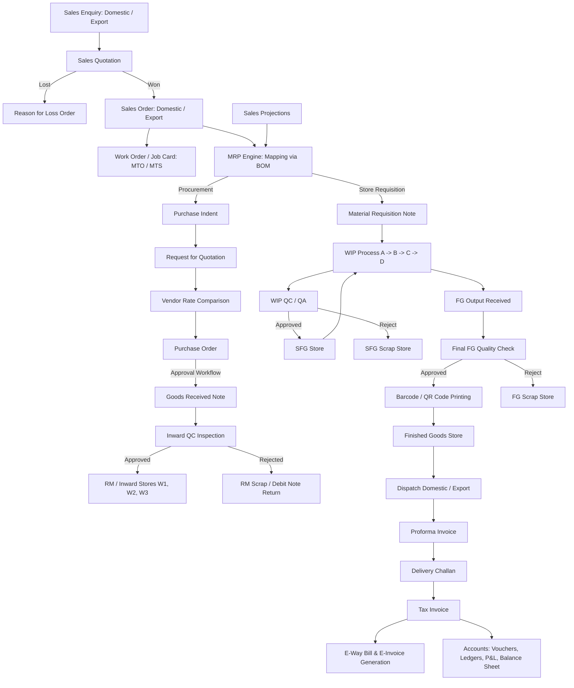

# Prodexa ERP: Workflow Gap Analysis & Remaining Features Specification

> **Reference Document:** *Prodexa ERP Enterprises Business Module - Flow Chart (11 Pages, Synture Solutions Pvt. Ltd.)*  
> **Codebase:** *Prodexa Next.js / TypeScript / Tailwind / MongoDB ERP Suite*  
> **Prepared For:** Synthesis with incoming *Udyog ERP Reference PDF*

---

## Executive Summary

The **Prodexa ERP Flow Chart** outlines an end-to-end discrete manufacturing enterprise workflow spanning from **Lead Generation** through **Material Planning (MRP)**, **Procurement & Inward QC**, **Multi-stage WIP Production & Scrap handling**, **Finished Goods Barcode Labeling**, **Tax Invoicing & E-Way Bill**, **Dual Subcontracting Job Work**, through **Full Double-Entry Financial Accounting** and **Enterprise Utilities**.

While Prodexa already has foundational models and dashboards for several core domains, significant **functional gates, document lifecycles, and UI interfaces** remain to achieve parity with the enterprise manufacturing standard illustrated in the flowchart.

---

## Master Workflow Architecture Map



---

## Detailed Gap Analysis by Module (Flowchart vs. Current Codebase)

### 1. Sales & CRM Pipeline (PDF Page 2)

| Process Step in Flowchart | Current Prodexa Status | Remaining Functionality | Remaining UI Requirements |
| :--- | :--- | :--- | :--- |
| **Sales Enquiry** (Domestic vs. Export) | Partially built (`/dashboard/sales`) | Enquiry source & domestic/export flags; automatic follow-up reminders. | Multi-tab Enquiry view (Domestic vs Export), Follow-up Scheduler modal (Date, Mode: Call/SMS/Email, Notes). |
| **Follow-ups & Alerts** | Basic log | Cron/scheduled alert trigger for pending follow-ups; customer communication history log. | Follow-up history timeline & upcoming task widget on CRM dashboard. |
| **Sales Quotation** | Built with bicycle presets | Versioning (Rev-01, Rev-02); terms & conditions presets; GST calculation. | Quotation Print/PDF layout generator; revision compare drawer. |
| **Win / Loss Decision Gate** | Status changes to LOST | **Mandatory "Reason for Loss" capture** (Competitor, Price, Lead Time, Spec Mismatch, Budget Cancelled). | "Mark as Lost" Modal prompting category & detailed reason; Lost-order Analytics chart. |
| **Sales Order Creation** | Built (`/dashboard/orders`) | Auto-locking price & terms upon quotation conversion; export currency handling. | Dual toggle: Domestic GST Invoice Order vs Export Shipping Order (Incoterms, Port, Currency). |
| **Work Order / Job Card Trigger** | Direct work orders | Bifurcation of demand type: **Make to Order (MTO)** tied to SO vs **Make to Stock (MTS)** tied to forecast. | Job Card creation wizard with MTO/MTS selector and auto-assignment to production line. |

---

### 2. MRP – Material Requisition Planning (PDF Page 3)

| Process Step in Flowchart | Current Prodexa Status | Remaining Functionality | Remaining UI Requirements |
| :--- | :--- | :--- | :--- |
| **Dual Demand Input** | Only pulls confirmed Orders | Input from **Sales Orders + Sales Projections / Monthly Forecast**. | Forecast Entry screen with month-wise target quantities per SKU. |
| **Multi-Level BOM Mapping** | Flat single-level BOM | Recursive BOM explosion supporting **RM** (Raw Material), **SFG** (Semi-Finished Goods), and **PM** (Packaging Materials). | Tree-view hierarchical BOM Explorer with sub-assembly drilldown. |
| **MRP Calculation Matrix** | Basic shortfall table | Dynamic calculation engine applying: `Required = (Gross Req + ReOrder Level) - (Available Stock + Open PO Qty + Open Work Orders)`. | Enterprise Grid showing: Item Type (RM/SFG/PM), Req Qty, In Stock, PO Pipeline, Reorder Level, Net Indent Qty. |
| **Material Requisition Note (MRN)** | Missing | Generation of formal MRN document reserving stock and dispatching slip to warehouse. | MRN Document List & Creation Modal with batch-reservation preview. |
| **Purchase Indent** | Missing | Automatic generation of consolidated Indents grouped by preferred vendor/category. | Indent Approval Board (Pending Indents -> Consolidated Indent -> Convert to RFQ). |
| **RFQ & Vendor Rate Comparison** | Missing | Multi-vendor RFQ dispatch; quotation receipt entry; comparative statement generator. | **Rate Comparison Matrix UI** (Side-by-side comparison of Vendor A, B, C: Price, Freight, GST, Delivery Lead Time, Payment Terms). |

---

### 3. Purchase & Inward Stores (PDF Page 4)

| Process Step in Flowchart | Current Prodexa Status | Remaining Functionality | Remaining UI Requirements |
| :--- | :--- | :--- | :--- |
| **PO Multi-Level Approval** | Single manager approval | Multi-tier approval rules based on amount threshold (e.g. >₹1L requires Director); Reject with Re-draft loop. | PO Approval Workflow Modal with approval history chain, rejection remarks, and re-drafting interface. |
| **PO Supplier Dispatch** | In-app view only | Automatic PDF generation and email/WhatsApp dispatch to vendor with acknowledgement link. | "Send to Vendor" action menu with PDF attachment preview and dispatch log. |
| **Goods Received Note (GRN)** | Combined in `ReceiveGoodsModal` | Dedicated GRN document creation with gate entry number, vendor delivery challan number, and vehicle number. | Standalone GRN Management screen; Gate Inward Entry form with physical verification checklist. |
| **Inward QC Gate** | Separate `/dashboard/quality` | **Blocking quarantine gate:** Stock remains in `QUARANTINE` store until QC Inspector marks Accepted/Rejected. | Inward Inspection checklist modal launched directly from GRN with parameter-level tests (Dimensions, Tensile, Visual). |
| **Rejection Handling** | Quantity field only | Rejection routing: **Inward Scrap** (non-returnable) vs **Purchase Return / Debit Note** (return to vendor). | Return-to-Vendor (RTV) Challan generator and auto-creation of Debit Note in Accounts. |
| **Multi-Warehouse Store Put-Away** | Basic location text string | Systematic bin & warehouse allocation (**Store W1: Raw Material, W2: Fasteners, W3: Chemicals/Paint**). | Visual Warehouse Put-Away Selector (Warehouse -> Zone -> Rack -> Bin) upon QC approval. |

---

### 4. Production & Work-In-Progress (WIP) (PDF Page 5)

| Process Step in Flowchart | Current Prodexa Status | Remaining Functionality | Remaining UI Requirements |
| :--- | :--- | :--- | :--- |
| **Material Issue from Store** | Direct stock deduction | Store confirmation workflow: Production issues MRN -> Storekeeper verifies & issues physical stock. | Store Issue Slip UI with barcode scanner confirmation for issued raw materials. |
| **Sequential WIP Stages** | Flat status toggle | Configurable routing: **Process A -> Process B -> Process C -> Process D** (e.g., Cutting -> Welding -> Powder Coating -> Assembly). | **Interactive WIP Stage Kanban / Gantt Board** showing quantity currently held at each station. |
| **Stage-wise QC & Rejection** | Only end-of-line check | Intermediate stage inspections; scrap logging at each step with operator responsibility. | Quick "Log Stage Output" modal: Input Qty -> Good Qty -> Scrap Qty -> Rework Qty. |
| **SFG Store Management** | Unified inventory | Dedicated tracking of Semi-Finished Goods in intermediate store with batch codes. | SFG Inventory tab with conversion ratios and re-issue into final assembly work orders. |

---

### 5. Finished Goods QC, Barcode Labeling & Dispatch (PDF Pages 6 & 7)

| Process Step in Flowchart | Current Prodexa Status | Remaining Functionality | Remaining UI Requirements |
| :--- | :--- | :--- | :--- |
| **Final FG QC Inspection** | Generic check | Mandatory pre-dispatch quality sign-off; diversion of defective items to **FG Scrap Store**. | Pre-dispatch Inspection Certificate generation with pass/fail stamp and inspector digital signature. |
| **Barcode / QR Code Printing** | UI placeholders | **Thermal Label Generator**: Encodes Batch No, Serial No, SKU, Mfg Date, MRP into GS1-128 / QR standard. | **Label Printing Dialog** supporting standard thermal sticker sizes (50x25mm, 100x50mm) with print preview. |
| **Proforma Invoice (PI)** | Direct order completion | Creation of commercial PI for customer advance collection prior to physical goods dispatch. | Proforma Invoice template with bank details, terms, and convert-to-final-invoice button. |
| **Delivery Challan (DC)** | Basic pick list | Legal Delivery Challan under GST Rule 55 with transporter name, vehicle registration number, and LR number. | Delivery Challan generation view with multi-copy print format (Original for Consignee, Duplicate for Transporter, Triplicate for Consignor). |
| **Sales Tax Invoice & GST** | Basic mock invoices | Harmonized GST calculation (CGST+SGST for intra-state, IGST for inter-state) with HSN breakdown. | GST Compliant Tax Invoice layout with dynamic tax breakup table. |
| **E-Way Bill & E-Invoice** | Static display | Real NIC payload formatting: Generating JSON for NIC E-Way Bill portal & IRN QR generation. | Direct "Generate E-Way Bill" & "Generate IRN" buttons on invoice with portal JSON download & status tracking. |

---

### 6. Financial Accounting & Ledgers (PDF Page 8)

| Process Step in Flowchart | Current Prodexa Status | Remaining Functionality | Remaining UI Requirements |
| :--- | :--- | :--- | :--- |
| **Debit Note & Credit Note** | Partial in AR/AP | Formal voucher creation with linked tax invoices and GST credit reversals. | Debit Note / Credit Note Voucher entry screens with invoice reference picker. |
| **Cash & Bank Vouchers** | Basic payment modal | **Bank Payment, Bank Receipt, Cash Payment, Cash Receipt** with cheque/UTR numbers and bank reconciliation. | Multi-entry Cash/Bank voucher form with auto-balancing debit/credit ledger accounts. |
| **Petty Cash System** | Missing | Factory daily imprest account with expense voucher logging and replenishment cycle. | Petty Cash register with expense category tags, receipt image uploads, and petty cash balance tracker. |
| **Expense Purchases** | Merged with inventory POs | Indirect service/expense billing (Electricity, Maintenance, Office Supplies) without inventory movement. | Direct Expense Voucher form with TDS deduction and cost-center allocation. |
| **Journal & Contra Entries** | Basic mock GL | Manual Journal Vouchers (JV) for depreciation/accruals; Contra Vouchers for cash/bank transfers. | Traditional Double-Entry JV editor with debit/credit balance validator. |
| **Financial Statements** | Tabular summary | **Drill-down General Ledger, Sundry Debtors Aging (0-30-60-90+), Sundry Creditors Aging, Trial Balance, P&L, Balance Sheet**. | Interactive Financial Reporting Suite with expandable account tree and export to Excel/PDF. |

---

### 7. Labour Job Work / Subcontracting (PDF Page 9)

| Process Step in Flowchart | Current Prodexa Status | Remaining Functionality | Remaining UI Requirements |
| :--- | :--- | :--- | :--- |
| **Outward Job Work (We outsource)** | Basic subcontracting modal | Issue raw material under GST Job Work Challan (Rule 45); Track stock held by subcontractor; Receive finished SFG; Scrap loss reconciliation. | **Subcontractor Outward Challan (Challan A111)** generator, Subcontractor Stock Register, Inward Reconciliation view. |
| **Inward Job Work (We process for others)** | Missing | Receive customer raw materials without inventory ownership valuation; Service Sales Order; Processing tracking; Return Challan (B111) + Job Work Service Invoice. | Inward Job Work register, Customer Material Custody tracker, Service Delivery Challan & Service Tax Invoice. |
| **Job Work Statutory Register** | Missing | ITC-04 tracking (Materials sent for job work must return within 1 year for RM, 3 years for Capital Goods). | ITC-04 Compliance Dashboard with overdue aging alerts. |

---

### 8. Enterprise Utilities & System Administration (PDF Page 10)

| Utility in Flowchart | Current Status | Remaining Functionality | Remaining UI Requirements |
| :--- | :--- | :--- | :--- |
| **File Upload / DMS Utility** | Missing | Centralized file storage for attaching drawings, test certificates, vendor invoices, contracts. | Drag-and-drop Attachment Drawer on every transaction screen with file preview. |
| **Multi-Level Approval Matrix** | Hardcoded roles | Configurable workflow rules engine (Module -> Value Threshold -> Approver Hierarchy). | Approval Configuration Admin Panel & "Pending My Approval" global inbox. |
| **Auto Email & SMS/WhatsApp** | Missing | Webhook/SMTP/Twilio/WhatsApp Cloud API triggers for PO dispatch, order confirmation, dispatch alerts. | Notification Template Manager (Variables like `{{orderNumber}}`, `{{customerName}}`) & communication log. |
| **Periodic Data Locking** | Missing | Financial year / month-end lock preventing modification or backdating of posted transactions. | Accounting & Inventory Period Lock settings page with password override for Admins. |
| **Tally ERP Data Transfer** | Missing | Export engine generating standard Tally XML vouchers for Sales, Purchase, Receipts, Payments. | **Tally Export Utility UI**: Select Date Range -> Choose Voucher Types -> Download Tally XML. |
| **BI MIS Reporting Tool** | Basic recharts | Pivot table / query builder for cross-module reporting (Cost per unit, Machine OEE, Supplier quality rating). | Interactive Pivot & Custom Report Builder with drag-and-drop dimensions and metrics. |

---

## Action Plan & Phased Roadmap

```
Phase 1: Sales Lifecycle & MRP Expansion
├── Implement Reason for Loss Order modal & analytics
├── Add MTO vs MTS work order classification
├── Build Multi-vendor RFQ & Rate Comparison Matrix UI
└── Build Material Requisition Note (MRN) & Purchase Indent models

Phase 2: Purchase Inward, Quarantine & Put-away
├── Dedicated GRN document generator with Gate Inward details
├── Quarantine Store state & Inward QC Pass/Reject gate
├── Purchase Return (Debit Note) automation
└── Store W1, W2, W3 bin allocation utility

Phase 3: Production Routing & Finished Goods
├── Multi-stage WIP process routing (Stages A, B, C, D)
├── SFG store tracking and scrap logging per stage
├── FG Final Quality Sign-off gate
└── Barcode & QR Code thermal sticker printing utility

Phase 4: Dispatch, GST Logistics & Accounting Vouchers
├── Proforma Invoice & GST Rule 55 Delivery Challan generator
├── E-Way Bill & E-Invoice NIC compliant JSON generator
├── Vouchers: Debit Note, Credit Note, Cash/Bank, Contra, Petty Cash, Journal
└── Sundry Creditors & Debtors aging drill-down tables

Phase 5: Subcontracting Job Work & Enterprise Utilities
├── Outward & Inward Job Work Challans (A111 & B111) with ITC-04 tracking
├── Centralized Document Management (DMS) file attachment drawer
├── Tally ERP XML Data Transfer utility
└── Financial and Inventory Period Locking tool
```
